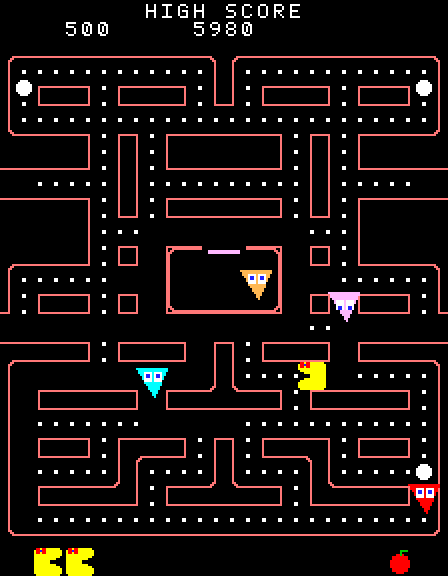

# Packer Fan (`pacfan`)

Arcade dot-eating maze game with ghosts built in Go using [Raylib](https://github.com/gen2brain/raylib-go) and the [Donburi](https://github.com/yohamta/donburi) Entity Component System (ECS). Supports both **Ms. Pac-Man** (default) and classic **Pac-Man** (`-pacman`) mazes, sprites, death animations, and intermissions.



*Gameplay with the placeholder example artwork (`go run . -ex`).*

See [Documentation](#documentation) for the architecture overview, asset format reference, and scripting API design.

## Prerequisites

- **Go 1.27+** (see [go.mod](go.mod))
- **Local artwork assets**: For copyright reasons, the original artwork is not included in this repository. To run the game with it, place compatible `assets/game.png` and `assets/text.png` files locally (originally sourced from [The Spriters Resource](https://www.spriters-resource.com/); see [assets/README.md](assets/README.md) for expected dimensions and layout).

> **No artwork?** Run with `-ex` to use the placeholder spritesheets `assets/game-example.png` and `assets/text-example.png` included in the repository. They use simple shapes and original maze layouts, drawn at the same positions as the real artwork. Regenerate them with `go run ./tools/genexample assets/game-example.png assets/text-example.png`.

> **Note**: `go test ./...` runs headlessly without Raylib or artwork, skipping only spritesheet-backed validation checks when `assets/game.png` is absent.

## Running the Game

```sh
go run .
```

Pass CLI flags directly when running with `go run`, for example:

```sh
go run . -pacman -zoom 4
```

### CLI Flags

| Flag | Default | Description |
| --- | --- | --- |
| `-zoom` | `3` | Integer display scale factor (clamped to `1..10`) |
| `-pacman` | `false` | Use classic Pac-Man maze, sprites, death animation, and intermissions instead of Ms. Pac-Man |
| `-players` | `1` | Default player count on the attract screen (`1` or `2`) |
| `-mute` | `false` | Disable arcade audio playback |
| `-ex` | `false` | Use the placeholder example artwork (`assets/game-example.png`, `assets/text-example.png`) instead of `assets/game.png` and `assets/text.png` |

### Controls

- **1 / 2** (on Attract screen): Start a 1-player or 2-player game
- **Enter / Space** (on Attract screen): Start with the selected player count
- **Arrow Keys** (`Up`, `Down`, `Left`, `Right`) or **WASD** (`W`, `A`, `S`, `D`): Steer Pac-Man / Ms. Pac-Man
- **Space**: Pause / resume gameplay
- **M**: Mute / unmute audio
- **Any Key** (on the Game Over screen, after a 1-second delay): Return to the Attract screen to pick 1P or 2P (or returns automatically after 3 seconds)

### Useful Make Targets

```sh
make build      # Build the ./pacfan binary
make run        # Build and launch ./pacfan (pass flags via ARGS="-pacman -zoom 4")
make test       # Run all unit, ECS simulation, and scene tests
make test-race  # Run all tests with the race detector enabled
make cover      # Run tests and print statement coverage
make check      # Run go fmt, go vet, and race-checked tests
make fix        # Run go fix modernizers
make generate   # Run go generate ./... (regenerate stringer enum helpers)
make clean      # Remove build and coverage artifacts
make help       # List all available targets
```

---

## Documentation

| Document | Description |
| --- | --- |
| [docs/ecs.md](docs/ecs.md) | Architecture overview: project layout, Donburi entities and components, the world-scoped event bus, the scene state machine, the game loop and simulation pipeline, and the audio and rendering pipeline. |
| [assets/README.md](assets/README.md) | Asset reference: the files the game embeds, the `game.png` maze and sprite atlas layout, the `text.png` font layout, the placeholder example artwork, and the optional WAV audio files. |
| [machine.md](machine.md) | Plan for running the game headlessly so a machine-learning agent can play far faster than real time, with deterministic input-log replays (`.pfr` files) for watching the agent improve in the normal game window. |
| [scriptable.md](scriptable.md) | Design proposal (not yet implemented) for a scripting and machine-learning API: operating modes, a wire protocol for observing state and sending controls, observation and reward design, an implementation plan, and an example Python Gymnasium client. |

---

## Background

- [The Pac-Man Dossier](https://www.gamedeveloper.com/design/the-pac-man-dossier)
- [Donburi ECS for Go](https://github.com/yohamta/donburi)
